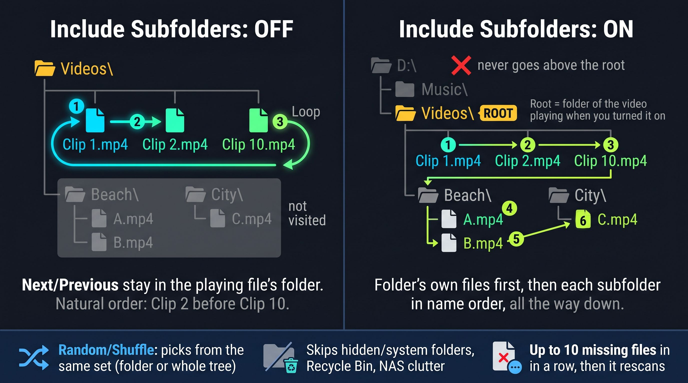

# Moving between files: folders, subfolders, lists and Aspect Filter

Graphic: [How folder stepping works](../images/folder-navigation.jpg)

Each cell moves on by itself. Next and Previous (N / B, PgDn / PgUp), Random (Shift+N) and Back to Previous Random (Shift+B) work on the cell under the cursor; Shift versions in the menu work on all cells.

## Include Subfolders OFF

- Next / Previous step through the files in the playing video's own folder.
- Order is natural name order: "Ep 2" comes before "Ep 10".
- Random picks from that same folder. Shift+B goes back through up to 1,000 earlier random picks.

## Include Subfolders ON (default)

- The folder of the video playing when you turn it on becomes that cell's **root**.
- The cell walks everything under the root, depth first: a folder's own files first, then each subfolder in name order, all the way down.
- The root's own files are included. Nothing above the root (its parent, its siblings, the drive) is ever used.
- Random and Shuffle pick from the whole tree under the root.
- Tip: turn it on while a video from the folder you want as root is playing. If the playing video is in a subfolder, that subfolder becomes the root.
- Example: one panel per performer. A video from `...\_downloads\PerformerName\` makes that folder the root, so the panel stays with that performer. A cell started from `...\_downloads\` mixes all.
- All videos: Include Subfolders On / Off [ALL]. New videos follow the default, and the setting is saved with the playlist.

### What is skipped

- Hidden and system folders (can be turned off in Playlist settings).
- `$Recycle.Bin`, `System Volume Information`, `lost+found`, and NAS clutter (`@eaDir`, `#recycle`, `#snapshot`, `.Trash-*`). These only appear at a drive's top or on network shares.
- Junction loops.
- Very large trees: a scan stops after a set number of entries.
- Missing files: up to 10 in a row are passed over, then the folder is scanned again.

## Lists (single-cell playlists)

Press **L** (List...) on a cell to give it its own list of files and links. A list can come from:

- a folder (with or without subfolders),
- an M3U / M3U8 file,
- a URL (for example a web M3U).

Lists are saved with the playlist, and several cells can play from one list (for example four cells on four channels of one channel list). A linked list can re-read its source when the playlist loads, so edits and new files show up. A list can be exported as M3U8 for other players. **Leave the List** returns the cell to folder stepping.

## Aspect Filter (Off / Skip / Ask)

Decides what a cell does when the next file is the other orientation from the cell (a cell taller than wide wants portrait files). It only affects moving on, never the video already playing.

- **Off**: play whatever comes next.
- **Skip**: pass over files of the other orientation, looking at up to 10 files per step.
- **Ask**: pause and ask "Play anyway / Skip".

Current limits (fix planned for 0.2beta): the setting is per cell, saved only with a saved playlist, has no all-videos version and no default in Settings, and the cell's shape is measured live, so resizing the grid can change what fits.

## Coming in 0.2beta

- Aspect Filter default in Settings, plus an All Videos version.
- Images (jpg, png, webp, gif and more) as slides: folder stepping finds them, a Slide duration setting, and When Finished runs at the end of each slide. Images-and-videos or one kind only, per cell and for all cells.
